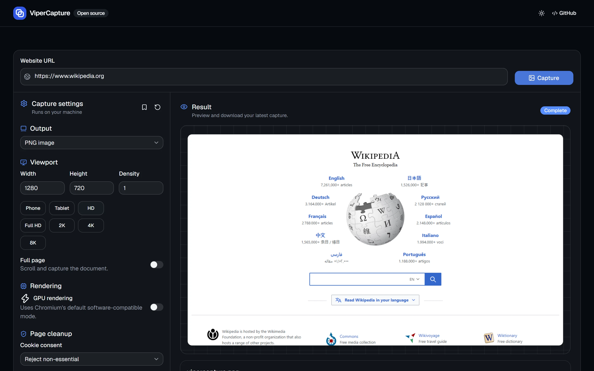

<p align="center"></p>

<h1 align="center">ViperCapture</h1>

<p align="center">The self-hosted browser rendering API.</p>

<p align="center"><a href="#install"><strong>Install</strong></a> · <a href="#documentation">Docs</a> · <a href="docs/api.md">API</a> · <a href="#docker">Docker</a> · <a href="https://github.com/Viperisuseful/ViperCapture/releases">Releases</a></p>

<p align="center"></p>

ViperCapture renders web pages on your own machine. The JSON API and the `vipercapture capture` command take a URL, raw HTML, or Markdown and return screenshots, PDFs, video, rendered HTML, Markdown, or page metadata. The web UI and the terminal menu capture a URL in a few keystrokes.

If you are moving from ScreenshotOne or Urlbox, compatibility adapters at `GET /take` and `POST /compat/urlbox/v1/render/{sync,async}` accept their common request options. The [compatibility matrix](docs/compatibility.md) lists what matches, and the [migration guide](docs/migration-screenshotone-urlbox.md) covers the rest.

## What you get

- **Three browser engines.** Render with Chromium, Firefox, or WebKit in a fresh isolated context per request.
- **Images, PDFs, video, and page data.** Output PNG, JPEG, WebP, AVIF, PDF, rendered HTML, Markdown, JSON metadata with CSS-selector extraction, or WebM, MP4, and GIF video. One page load can return a ZIP with side artifacts and up to five named thumbnails.
- **Actions, waits, and cleanup.** Click, hover, fill, select, scroll, wait on selectors or images, and assert page content before capture. Built-in rules block ads, trackers, and chat widgets, and the vendored AutoConsent rules answer cookie consent dialogs.
- **Async jobs, schedules, and webhooks.** Queue durable work at `POST /v1/jobs`, batch up to 100 items at `POST /v1/jobs/bulk`, or run five-field cron schedules in any IANA timezone. Set a webhook secret to get HMAC-SHA256 signed callbacks. The bundled job and schedule stores run on Linux, macOS, and Docker. Native Windows needs Docker, or external job, artifact, and schedule providers plus `VIPERCAPTURE_JOB_SECRET`, as described in [async jobs](docs/async-jobs.md).
- **Local or S3-compatible storage.** Save job results locally or write them to AWS S3, Cloudflare R2, MinIO, or Backblaze B2.
- **Visual diffs and baselines.** Compare two images at `POST /v1/diff` for a ZIP report with pixel counts and a highlighted diff image, or store project baselines.
- **Projects and API keys.** Enable the optional control plane for hashed API keys, quotas, and encrypted browser profiles.
- **Metrics and tracing.** `GET /metrics` serves Prometheus metrics, and setting `OTEL_EXPORTER_OTLP_ENDPOINT` turns on OTLP tracing.
- **MIT licensed.** The JSON API follows semantic versioning, and the self-hosted engine runs with no hosted account.

## Install

Video output needs a full FFmpeg build on `PATH` with the `libvpx`, `libvpx-vp9`, and `libx264` encoders. Get it from your package manager or the [FFmpeg download page](https://ffmpeg.org/download.html). The Docker image includes FFmpeg. See [self-hosting](docs/self-hosting.md) for Intel macOS builds, terminal options, and production settings.

### Command line

On Linux or macOS:

```bash
curl -fsSL https://raw.githubusercontent.com/Viperisuseful/ViperCapture/master/scripts/install.sh | bash
```

On Windows PowerShell:

```powershell
irm https://raw.githubusercontent.com/Viperisuseful/ViperCapture/master/scripts/install.ps1 | iex
```

The installers add `vipercapture` to your `PATH`. If they can't find Python 3.11 or newer, they use [uv](https://docs.astral.sh/uv/) to install Python 3.12, and install uv first if needed.

Run `vipercapture`. On Linux and macOS, open a new terminal first. The first run creates a private environment, installs Python dependencies with Chromium, Firefox, and WebKit, starts the API at `http://127.0.0.1:8000/v1`, and opens the web UI at `http://127.0.0.1:8000`.

| Command | Action |
| --- | --- |
| `vipercapture` | Start the local server and open the web UI at `http://127.0.0.1:8000`. |
| `vipercapture --gui` | Open the full-screen terminal capture menu for PNG, GIF, and MP4 output. |
| `vipercapture capture URL --output FILE` | Capture a URL through the local API and write it to `FILE`. |
| `vipercapture update` | Download the latest release and keep your environment, `.env.local`, jobs, and presets. |
| `vipercapture kill` | Stop all running local ViperCapture servers, menus, and workers. |

### Docker

Run the published image:

```bash
docker run --rm --init -p 127.0.0.1:8000:8000 ghcr.io/viperisuseful/vipercapture:1.1.0
```

Or build and run with Compose from a clone of this repository:

```bash
docker compose up --build
```

Compose binds to loopback by default and keeps durable queue state, encryption keys, schedules, cache entries, and local artifacts in a named volume.

### From source

This path needs Python 3.11 or newer.

```bash
git clone https://github.com/Viperisuseful/ViperCapture.git
cd ViperCapture
python launch.py
```

`python launch.py` runs the same setup path as `vipercapture`. It prefers `uv` when available on `PATH` and falls back to `venv` and `pip`.

## Your first capture

Send a JSON request to `POST /v1/render`:

```bash
curl --fail-with-body http://127.0.0.1:8000/v1/render \
  -H 'Content-Type: application/json' \
  -d '{
    "url": "https://example.com",
    "output": "png",
    "full_page": false,
    "viewport": {"width": 1280, "height": 720},
    "actions": [{"type": "hide", "selector": ".newsletter"}],
    "cleanup": {"block_ads": true, "consent_mode": "reject"},
    "assertions": {"content_includes": ["Example Domain"]}
  }' --output example.png
```

Or capture a page from the CLI:

```bash
vipercapture capture https://example.com --output example.png --viewport 1440 900 --full-page=false
```

Stdout is the saved file path, and `vipercapture capture --help` lists every flag.

## "Is this a hosted service?"

No. This repository holds the MIT-licensed rendering engine, JSON API, CLI, and browser UI that you run on your own hardware.

Accounts, billing, credits, and hosted infrastructure belong to a separate product. Async jobs, cron schedules, S3 storage, visual diffs, and project API keys all live in this repository.

## Documentation

- [Full feature list](docs/features.md)
- [API and workflows](docs/api.md)
- [Async jobs and queue providers](docs/async-jobs.md)
- [Projects, API keys, and observability](docs/platform.md)
- [Self-hosting and production setup](docs/self-hosting.md)
- [ScreenshotOne and Urlbox compatibility matrix](docs/compatibility.md)
- [Migrating from ScreenshotOne or Urlbox](docs/migration-screenshotone-urlbox.md)
- [Authorizing ViperCapture through Cloudflare or a WAF](docs/site-access.md)
- [Public API deployment example](deploy/public-api)

For harder bot challenges, see [ViperCapture Stealth](https://github.com/Viperisuseful/ViperCapture-Stealth), a separate fork. It is not a universal Cloudflare bypass.

## Contributing

- Read [CONTRIBUTING.md](CONTRIBUTING.md) before opening a pull request or proposing a large feature.
- Keep pull requests small and focused on one change.
- Build the frontend and run `scripts/smoke.py` before submitting.
- Report security issues privately per [SECURITY.md](SECURITY.md).

## License

[MIT](LICENSE). AutoConsent assets under `vendor/autoconsent` keep their upstream license and attribution.
